# Схема workflow проекта RE_web_presale

Сквозной процесс: агенты, документация, гейты с участием владельца (Константин),
коммиты/пуши, деплой. Канон правил: `product_docs.md` (этот каталог), `AGENTS.md`
(«Живая документация продукта»), `product_docs/README.md`, `tasktracker.md`,
`.gitlab-ci.yml`, `infra/deploy.md`.

```mermaid
flowchart TD
    subgraph ANALYSIS["1. Аналитика — агент analyst (фазы BABOK: python phase.py)"]
        A1["input/: интервью, модель ROS v2, скрины"] --> A2["Главы 3-6: планирование, выявление, стратегия. Слой 1: output/reports/"]
        A2 --> A3["Глава 7.1: спеки FR / UC / NFR / BR в output/data/re_web_presale/specs/ + граф 5.1 (draft)"]
        A3 --> A4["Глава 5.4: дельта вне baseline - Change Request CR-NNN"]
        A4 --> G1{"ГЕЙТ 1 - владелец: решение по CR"}
        G1 -->|"approved"| A5["Глава 5.5: пакет утверждения (baseline v1.0; при новой функции - v2.0)"]
        A5 --> G2{"ГЕЙТ 2 - владелец: приёмка пакета 5.5"}
    end

    G2 -->|"шаг «синхронизировать product_docs»"| SYNC["Sync слоя 2 (только аналитик): карточка BF-NN в planned с разделом «Планируемое изменение», страница компонента, INDEX.md, check_product_docs.py без ошибок"]

    SYNC --> TRACK[("YouGile REW: запись «аналитика по BF-NN завершена» + ссылки")]
    TRACK --> GATE{"ВОРОТА Arch/Dev/QA: карточка planned + 5.5 approved + задача в трекере"}
    GATE -->|"не пройдены: вернуть аналитику"| GATEBACK["архитектор называет причину, задача возвращается аналитику"]
    GATE -->|"пройдены"| ARCH["2. Агент arch: декомпозиция на задачи, ADR, целевые страницы planned, блок «Архитектурное решение»"]

    ARCH --> UXPH["3. Агент ux: 2-3 варианта экрана, design/KON-N/"]
    UXPH --> G3{"ГЕЙТ 3 - владелец: апрув decision.md"}
    G3 -->|"approved"| TASKS["Dev/QA-задачи в трекере (ссылки на BF-NN, FR-ID, страницы компонентов)"]

    subgraph DEVPH["4. Разработка — агент dev"]
        TASKS --> D1["Backlog - ворота проверены - взял: In Progress (YouGile)"]
        D1 --> D2["Ветка dev/kon-N; коммит с типом и номером KON-N / REW-N; push"]
        D2 --> CG{"CI GitLab: lint_test + secrets + db-isolation"}
        CG -->|"green"| D3["Локальный QA-гейт: backend ruff+pytest; frontend eslint+vitest+build; check_secrets; db-isolation"]
    end

    D3 --> IR[("In Review: описание задачи обновлено - что сделано / что осталось")]
    IR --> QA["5. Агент qa: приёмка против decision.md и спеки; контрольный пример из FR; обе темы, 1280/1024; отчёт в qa/"]
    QA --> G4{"Pass?"}
    G4 -->|"замечания"| BUG["Баг-задача на dev: In Progress, новый коммит в ветку"]
    BUG --> D2
    G4 -->|"Pass"| FACT["6. Аналитик приводит страницы к факту: BF-NN в implemented, страница компонента обновлена, check_product_docs.py = 0"]

    FACT --> DONE[("Done в трекере (без апрува владельца не переносить)")]
    DONE --> DEP["7. devops / владелец: merge в main + push"]
    JOB["Ops-1 (REW-32): CI db-isolation перезаписывает локальный .env — не должен"]
    JOB -.- DONE
    subgraph DEPLOY["8. Деплой — deploy.ps1 (один вызов владельца; ssh-ключ с фразой)"]
        DEP --> SH["deploy.ps1: локальные проверки -> git archive -> scp на ВМ\n deploy.sh: flock, app.prev x3, миграции при изменении db/migrations (с дампом KON-49),\n compose build/up, ожидание /health 300 с, автооткат при сбое"]
        SH -->|"красно"| RB["Авто-откат на app.prev, владелец уведомлён"]
        SH -->|"зелено"| LIVE["DEPLOYED_VERSION, https://vm-re.simbirsoft/"]
    end

    LIVE --> G5{"ГЕЙТ 4 - владелец: приёмка в браузере - вход (LDAP), бизнес-функции, Jira; учётные данные вводит сам, агент их не использует"}
    G5 -->|"принято"| EPILOG["Функция в работе; дельта замечаний - через CR 5.4 / задачу"]
```

## Гейты с участием владельца

| № | Гейт | Готовит | Артефакт решения |
|---|---|---|---|
| 1 | Решение по CR (5.4) — весь скоуп/срок | analyst | `output/reports/re_web_presale/5_4_cr_decision_CR-NNN_*` (Approved) |
| 2 | Приёмка пакета утверждения (5.5) | analyst | `5_5_approval_package_APKG-*_*.md` |
| 3 | Апрув дизайна UI | ux | `design/KON-N/decision.md` → `approved` |
| 4 | Приёмка после деплоя (браузер: вход, бизнес-функции) | devops делает deploy, проверяет владелец | комментарий в задаче/чате |
| — | Особые: OpenSpec — только по подтверждению; смена стикеров/приоритета; удаление данных (депрекация вместо удаления); учётные данные — только сам владелец | — | — |

Приёмка задач без QA-агента (мелкие правки) — Done по факту приёмки владельцем.

## Плоскости документации и «один писатель»

| Плоскость | Папка | Кто пишет | Контроль |
|---|---|---|---|
| Журнал и требования (слой 1) | `output/` — data (MCP, JSON + specs), reports (события) | analyst (MCP глав BABOK) | граф 5.1 |
| Бизнес-функции | `product_docs/01_business_functions/BF-NN_*/README.md` | analyst | `python product_docs/check_product_docs.py` (ошибки = код 1) |
| Системные компоненты | `product_docs/02_system_components/` (SRV / API / SEQ / MAP / ERD / FLV) | analyst («как есть»); блок «Архитектурное решение» — arch | там же |
| Архитектура | `architecture/` (C4, ADR, NFR-матрица, развёртывание) | arch | ADR-номера |
| Дизайн UI | `design/KON-N/` (brief, варианты, decision.md, PNG) | ux | ворота Dev = `approved` |
| Код продукта | `frontend/src/`, `backend/app/`, `db/migrations/` | dev | CI |
| Тесты и приёмка | `qa/`, `backend/tests/`, `frontend/src/test/` | qa (+ dev unit) | отчёты `qa/` |
| Инфраструктура | `compose*`, `infra/`, `scripts/`, CI | devops | отчёты `infra/` |

Dev/QA/DevOps карточки БФ и страницы компонентов **не правят** — изменение поведения
описывается комментарием к задаче; аналитик приводит страницы к факту (5.2 / CR 5.4).

## Движение задачи в трекере (YouGile, доска «Задачи» REW)

`Backlog` → (взял задачу) `In Progress` → (код готов + локальный гейт + описание updated)
`In Review` → (QA Pass + слой 2 синхронизирован) `Done`.
Ограничения: ≤ 1 задача в In Progress на агента; ≤ 5 в In Review; Done — только после QA Pass
или приёмки владельцем (детали — `tasktracker.md`).

## Полные правила

- слой 2 и плоскости: `.agents/rules/product_docs.md`, `product_docs/README.md`;
- колонки трекера: `tasktracker.md`; UI-ворота Dev: `ui_workflow.md`;
- фазы BABOK (какой набор MCP активен): `python phase.py` — после смены фазы перезапуск сессии.
