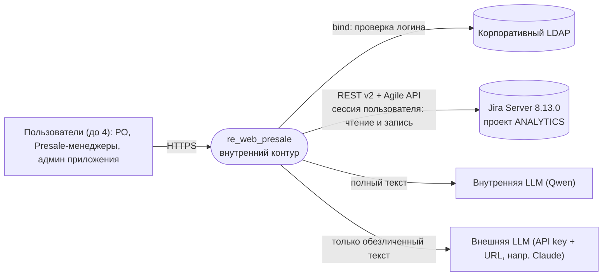
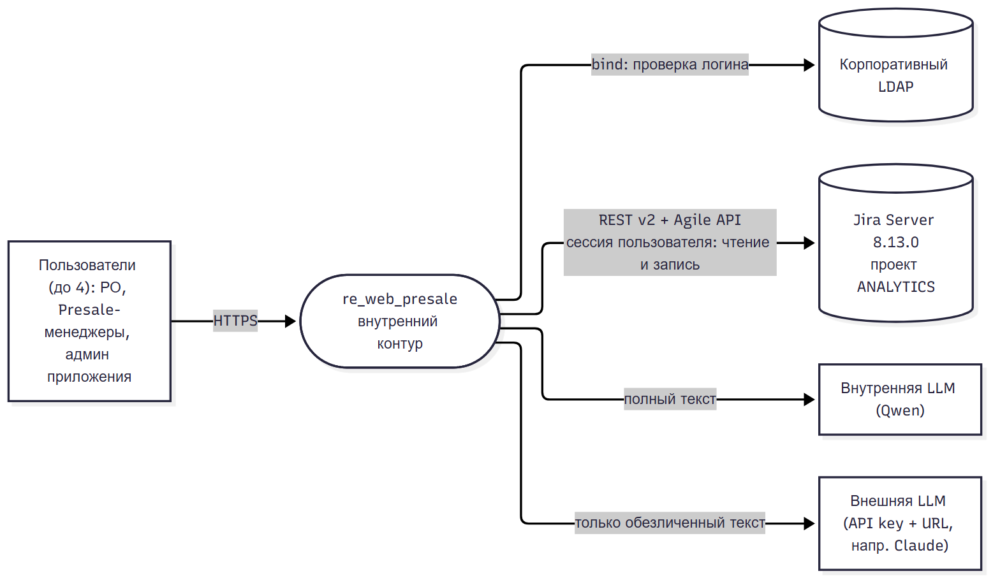
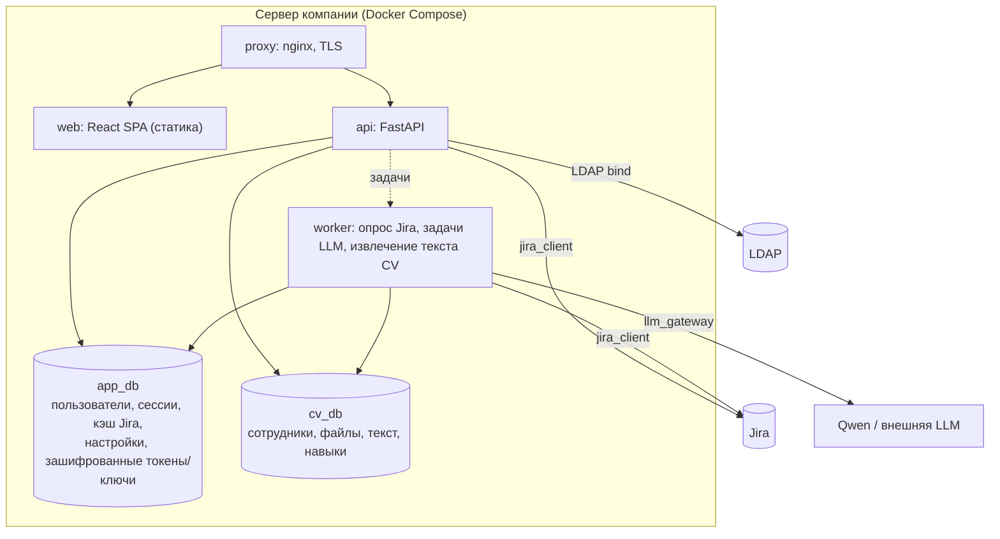
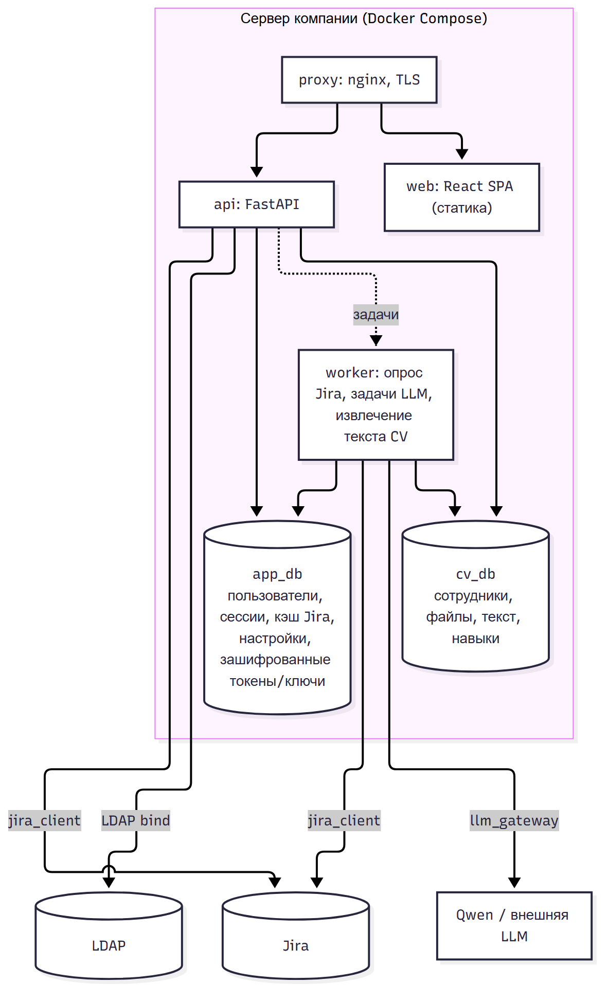
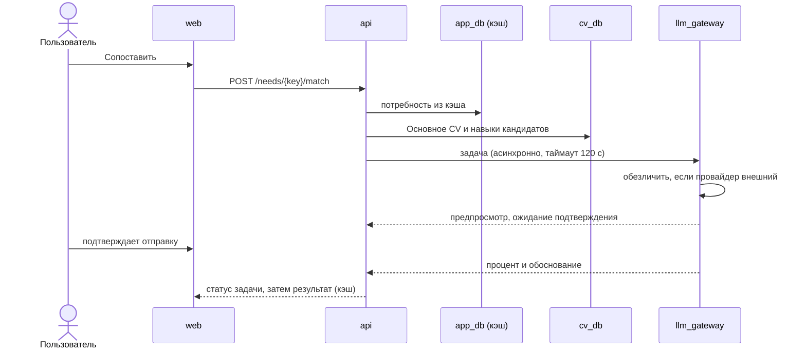

# C4 (контекст, контейнеры, компоненты)

## Уровень 1. Контекст

Границы: доступа извне нет (NFR-004); Jira остаётся основным источником данных, сбой приложения её не блокирует (NFR-003).

## Уровень 2. Контейнеры

Роли БД: `app_rw` (только `app_db`), `cv_rw` (только `cv_db`); каждая не видит чужую БД (NFR-007 п.3).
Доступ к `cv_db` только через слой `cv_repo`, к `app_db` только через `app_repo`.

## Уровень 3. Компоненты бэкенда (модули и владение кодом)

| Модуль | Ответственность | Требования | Владелец кода |
|---|---|---|---|
| `auth` | LDAP bind, список допущенных, серверные сессии | FR-021, FR-024, UC-006 | Dev-2 |
| `secrets` | AES-GCM шифрование токенов/ключей, фильтр секретов в логах | NFR-006 | Dev-2 |
| `integrations/jira` (`jira_client`) | Порт `JiraPort`: search_incremental, get_epic_children, get_issue, transitions; этап 2: assign, comment, attach, transition; сессионная cookie (`src/jira_client/`, готов) | FR-028, FR-029, FR-025, FR-008, FR-026 | OpenCode (Dev-3, Dev-11: доработка и интеграция) |
| `sync` | Планировщик опроса, кэш потребностей/сотрудников/эпиков, штамп «актуально на» | FR-020, FR-028, FR-034, NFR-008 | Dev-4 |
| `cv` | Файлы, типы, замена и архив, извлечение текста, навыки | FR-004, 022, 027, 037, 039, 040 | Dev-5 |
| `llm_gateway` | Провайдеры, обезличивание, предпросмотр, таймаут, асинхронные задачи | FR-023, FR-030, NFR-010 | Dev-6 |
| `matching` | Сопоставление, % и обоснование, кэш результата | FR-005, FR-036 | Dev-7 |
| `assign` (запись) | Оркестрация записи: перечитать, назначить, вложить, комментарий, статус | FR-008, 009, 010, 011, 018, 026 | Dev-12 |

Правило «один писатель на область»: модуль = область; фронтенд (`/frontend`) и бэкенд (`/backend`) разные области;
задачи Dev в бэкенде идут последовательно по зависимостям, `jira_client` ведёт только OpenCode.

## Ключевые потоки

Сопоставление (этап 1):

Назначение (этап 2): `api` перечитывает потребность из Jira, затем от имени пользователя (сессионный токен Jira) выполняет назначение, вложения, комментарий, смену статуса; при отказе возвращает текст Jira как есть, при 401 запрашивает повторную авторизацию, введённые данные остаются на клиенте (FR-029).
