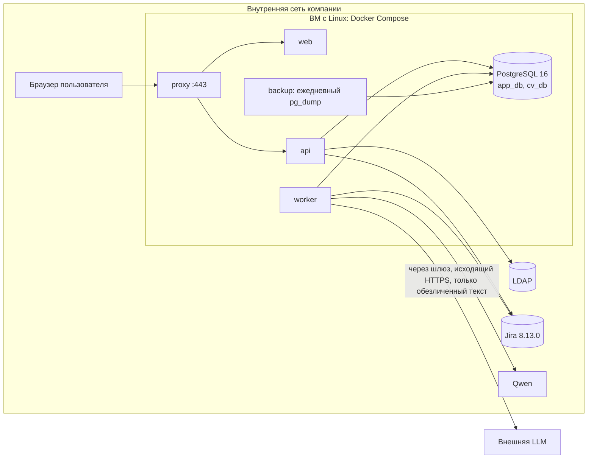

# On-premise развёртывание, LDAP, кэш Jira, токены, шлюз LLM

## Развёртывание (ADR-010)

Правила: входящий трафик только на 443 из внутренней сети; наружу разрешён только исходящий HTTPS на адреса внешних LLM из настроек;
секреты (`APP_ENC_KEY`, пароли ролей БД) передаются через env/secret-файлы сервера, не в образах и не в Git.
Окружения: local (Docker Compose на машине владельца: разработка, тесты, тестовый LDAP-контейнер) и prod (ВМ компании; заявка в Support подаётся после локального тестирования готового MVP; Docker и прочее ставим сами). Код: личный GitHub, перенос в корпоративный GitLab клонированием.
LLM: внутренняя Qwen по OpenAI-совместимому API, базовый URL `http://ollama-gpu.simbirsoft.com:3000/api/v1` (в env/настройках), ключ создаёт Константин, в репозиторий не пишется.

## LDAP (FR-024, FR-021, UC-006)
Параметры реального LDAP-сервера (хост, base DN, формат логина, TLS) не названы: открыто; разработка идёт с тестовым LDAP-контейнером, конфиг через env.
1. Пользователь вводит логин и пароль; `api` делает search + bind по LDAP (параметры из env: URL, base DN, фильтр).
2. Успех bind и логин в списке допущенных -> сессия приложения; тем же запросом создаётся сессия Jira (логин и пароль Jira совпадают с LDAP, решение владельца); пароль нигде не сохраняется, в логи не пишется (ADR-005, ADR-008).
3. Администратор приложения (первый админ задаётся env `ADMIN_LOGINS`) ведёт список допущенных, отзыв действует сразу.

## Кэш Jira (FR-028, ADR-004)
Таблицы в `app_db`: `jira_need`, `jira_employee`, `jira_epic`, `sync_state` (курсор `last_sync`, ошибки, время).
Доступ к Jira (KON-30, подтверждено): сессионная cookie пользователя, без тех. учётки и Application Link. Фоновый опрос идёт сессией активного пользователя и приостанавливается без активных сессий; при истечении сессии пользователь повторно вводит пароль, пароль не сохраняется (ADR-005).
Цикл `worker`: потребности 5 мин (JQL по `updated`, пересечение окна 1 мин для надёжности), сотрудники 1 час и по кнопке, эпики по открытию с TTL 1 час.
Идемпотентный upsert по `jira_key`. При отказе Jira: показываются данные кэша с пометкой и штампом, причина отказа выводится как есть (FR-029).
Поля Jira: `Epic Link = customfield_10101`, `parent`/`priority` не отдаются (см. `_api_notes.md`); весь код под REST v2.

## Хранение токенов (NFR-006, ADR-006)
Таблица `secret_store` в `app_db`: `owner`, `kind` (jira_session, llm_key), `ciphertext`, `nonce`, `key_id`.
Расшифровка только в момент вызова, в памяти процесса. Сессионные токены Jira привязаны к `user_id`; пароль пользователя нигде не хранится.

## Шлюз внешней LLM (FR-023, FR-030, ADR-007)
Порядок: выбор провайдера -> (внешний) обезличивание -> предпросмотр -> подтверждение пользователя -> вызов с таймаутом -> обратная подстановка -> результат в кэш.
Обезличивание: email, телефоны, URL (regex); имена сотрудников и клиентов, проекты (словари из кэша Jira и CV); ФИО и организации, локации (NER).
Критерий приёмки: 0 утечек на 5-10 реальных примерах (проверяет QA-2 по списку запрещённых строк, составленному вручную).
Ключи шифруются; смена провайдера и ключа только в «Настройках» администратором.

## Безопасность в целом
Только внутренний контур; HTTPS внутри; CSRF-токен на изменяющие запросы; ограничение размера и типа загрузок; логи без секретов и без текстов CV.
