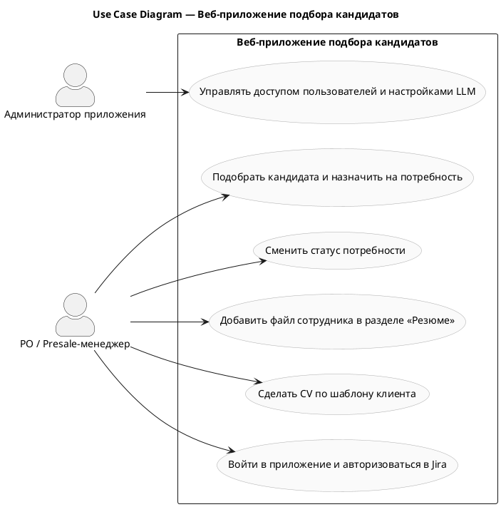

<!-- BABOK 7.1 — Use Case Diagram | Проект: re_web_presale | 2026-10-02 -->

# Use Case Diagram — Веб-приложение подбора кандидатов

**Проект:** re_web_presale  
**Use Cases на диаграмме:** 6  
**Акторы:** Администратор приложения, РО / Presale-менеджер  
**Файл диаграммы:** `output\data\re_web_presale\specs\uc_diagram_uc_diagram_re_web_presale_use_cases.puml`  
**Дата:** 2026-10-02

---

## PlantUML код

---

## Как рендерить

1. **PlantUML Online:** https://www.plantuml.com/plantuml/uml/
2. **VS Code:** расширение «PlantUML» (jebbs.plantuml)
3. **CLI:** `plantuml output\data\re_web_presale\specs\uc_diagram_uc_diagram_re_web_presale_use_cases.puml`

---

## Use Cases на диаграмме

| ID | Название | Статус |
|----|----------|--------|
| `UC-001` | Подобрать кандидата и назначить на потребность | draft |
| `UC-002` | Сменить статус потребности | draft |
| `UC-003` | Добавить файл сотрудника в разделе «Резюме» | draft |
| `UC-004` | Сделать CV по шаблону клиента | draft |
| `UC-005` | Войти в приложение и авторизоваться в Jira | draft |
| `UC-006` | Управлять доступом пользователей и настройками LLM | draft |