# Физическая модель БД re_web_presale (KON-29, Pre.RE-1)

Автор: агент Аналитик, скилл `analyst_db_designer_getanalyst`. Дата: 2026-10-05. Статус: проект на согласование.
СУБД: PostgreSQL 16, две базы `app_db` и `cv_db`, роли `app_rw` и `cv_rw` (ADR-002, ADR-003).
Источники: ERD-001, DD-001, FR-004/005/008/017/018/022/027/039/040, FR-014/015/016/021/028/030/033/035, NFR-004/005/006/007/008, ADR-003/004/005/006/009, `input/jira/_api_notes.md`.
Файлы: `db/migrations/` (DDL, индексы, up/down, порядок применения), `db/seed/` (обезличенные тестовые данные).

## 1. Принятые решения и допущения

| # | Решение | Основание |
|---|---------|-----------|
| D1 | Сотрудники, файлы, навыки, рекомендации живут в `cv_db`; пользователи, сессии, секреты, настройки, кэш потребностей и эпиков в `app_db`. Межбазовых FK и запросов нет, только мягкие ссылки по ключу Jira | ADR-003 |
| D2 | Сотрудник хранится один раз, в `cv_db.cv.employee` (кэш карточки Jira). Таблицы `jira_employee` из `05_deployment_security.md` в `app_db` нет, иначе два источника правды | FR-004, ADR-003 |
| D3 | Файлы CV лежат в БД (`bytea`, отдельная таблица `employee_file_content`), потолок 10 МБ задан CHECK. `file_path` из DD-001 не нужен | ADR-009, FR-004 |
| D4 | JSON-атрибуты ERD (`requirements_tags`, `skills_tags`, `statuses`) нормализованы в таблицы связей. JSONB оставлен только в `jira_epic.rules_cache` как непрозрачный кэш ответа Jira | стандарты скилла |
| D5 | `jira_token_encrypted` и `api_key_encrypted` вынесены в единый `app.secret_store` (AES-256-GCM: `ciphertext` с тегом, `nonce` 12 байт, `key_id`). Пароль Jira/LDAP не хранится нигде, колонки для него нет | ADR-005, ADR-006, NFR-006 |
| D6 | Аудит-таблицы нет, автоудаления данных нет. Пользователь «удаляется» флагом `active=false` | NFR-005, NFR-004, FR-021 |
| D7 | Время везде `timestamptz`; деньги `numeric(14,2)`; `FLOAT` не используется | стандарты скилла |
| D8 | Миграции под владельцем БД, приложение работает под `app_rw`/`cv_rw` с правами DML | NFR-007 |

## 2. Логическая модель

Сущности ERD-001 сохранены, добавлены нормализующие и служебные.

- Client (эпик Jira) 1:N Need; Need N:M Tag (`requirements_tags`).
- Employee 1:N EmployeeFile; EmployeeFile 1:1 FileContent; main_cv-файл N:M Skill.
- Recommendation: Need (мягко) N:1, Employee N:1, EmployeeFile (только основное CV) N:1.
- StatusGroup N:M StatusName (статус входит в несколько групп).
- AppUser 1:N Session; AppUser 1:N SecretStore(jira_session); LlmProvider 1:1 SecretStore(llm_key).

## 3. ER-диаграмма

```mermaid
erDiagram
    %% ---------- app_db ----------
    app_user ||--o{ app_session : "ldap_login"
    app_user ||--o| secret_store : "jira_session"
    llm_provider ||--o| secret_store : "llm_key"
    jira_epic ||--o{ jira_need : "epic_key (Client)"
    jira_need ||--o{ jira_need_tag : "need_key"
    status_group ||--o{ status_group_status : "group_id"

    app_user { text ldap_login PK "role, active" }
    app_session { bytea session_hash PK "expires_at, revoked_at" }
    llm_provider { int id PK "name, url, is_external, is_default, timeout_sec" }
    secret_store { bigint id PK "kind, ciphertext, nonce, key_id" }
    app_setting { text key PK "value" }
    status_group { int id PK "name, sort_order" }
    status_group_status { int group_id PK "status_name PK" }
    jira_epic { text epic_key PK "name, summary, rules_cache, rules_fetched_at" }
    jira_need { text jira_key PK "status, epic_key FK, employee_key, rate_*, jira_updated_at, synced_at" }
    jira_need_tag { text need_key PK "tag PK" }
    sync_state { text scope PK "last_sync_at, last_success_at, last_error" }

    %% ---------- cv_db ----------
    employee ||--o{ employee_file : "employee_key"
    employee_file ||--|| employee_file_content : "file_id"
    employee_file ||--o{ employee_file_skill : "file_id"
    employee ||--o{ recommendation : "employee_key"
    employee_file ||--o{ recommendation : "cv_file_id (main_cv)"

    employee { text jira_key PK "full_name, status, assignable, note, note_author" }
    employee_file { bigint id PK "employee_key FK, kind, is_archived, archived_at, extracted_text" }
    employee_file_content { bigint file_id PK "content bytea" }
    employee_file_skill { bigint file_id PK "tag PK" }
    recommendation { bigint id PK "need_key soft, match_percent, rationale, model" }
    cv_sync_state { text scope PK "employees" }
```

Мягкие ссылки между базами (без FK, ADR-003): `jira_need.employee_key` → `cv.employee.jira_key`; `cv.recommendation.need_key` → `app.jira_need.jira_key`; `cv.employee_file.client_epic_key` → `app.jira_epic.epic_key`.

## 4. Физическая модель

### app_db, схема `app`

| Таблица | Назначение | Ключ | Ограничения и заметки |
|---------|-----------|------|------------------------|
| `app_user` | список допущенных (FR-021) | `ldap_login` | роль user/admin, `active`; `display_name text NULL` (ФИО из LDAP `cn`, 1..256 символов, обновляется при каждом входе; NULL — показывается логин; e-mail не хранится) — V004, KON-60 |
| `app_session` | серверные сессии (ADR-008) | `session_hash` (sha256, 32 байта) | сам cookie не хранится; `expires_at > created_at` |
| `llm_provider` | LLM-провайдеры (FR-030) | `id` | уникальное имя, единственный `is_default` (partial unique), таймаут 1..3600 |
| `secret_store` | шифрованные секреты | `id` | `kind` jira_session/llm_key, владелец или провайдер строго по виду, nonce = 12 байт, ciphertext >= 16 байт, по одной записи на пользователя/провайдера |
| `app_setting` | настройки (jql_needs, vat_percent, max_file_mb) | `key` | формат ключа `[a-z0-9_]` |
| `status_group`, `status_group_status` | группы статусов (FR-035) | `id`; `(group_id, status_name)` | статус в нескольких группах допустим; 4 группы заполнены миграцией V007 (Без кандидата, Кандидат назначен, Интервью, Закреплён; 11 пар, «Интервью не пройдено» в двух группах); «Прочие» и «Все статусы» виртуальные |
| `jira_epic` | Client: эпик с правилами | `epic_key` | `rules_cache jsonb` + `rules_fetched_at` |
| `jira_need` | Need: кэш потребности | `jira_key` | см. п. 6; `employee_login text NULL` (V006, KON-61) — «Профиль сотрудника» `customfield_10707`, нижний регистр, CHECK 1..128, частичный индекс; `employee_key` ставится, только если логин однозначно найден в `cv.employee.jira_login`, иначе NULL (FK нет, ADR-003); валюты RUB/USD/KZT, EUR/GBR не применяются (решение владельца 09.10) |
| `jira_need_tag` | теги потребности | `(need_key, tag)` | теги в нижнем регистре |
| `sync_state` | состояние опроса потребностей | `scope = 'needs'` | курсор, штамп, ошибка; `last_error_code text NULL` (V005, KON-35: needs_reauthorization, no_permission, jira_unavailable, jira_error, not_enabled, error; NULL - последний опрос успешен) |

### cv_db, схема `cv`

| Таблица | Назначение | Ключ | Ограничения и заметки |
|---------|-----------|------|------------------------|
| `employee` | Employee: кэш карточки Jira + заметка | `jira_key` | заметка всегда с автором и датой (FR-033); V006 (KON-61): `jira_login` («Профиль сотрудника» 10707, не UNIQUE — дубль означает неоднозначное сопоставление, CHECK нижний регистр 1..128, частичный индекс), `vacation_plan` (поле «Отпуск» 10814 как есть, CHECK длины 1..128; даты отпусков и задачи VACATION-* не хранятся); «описание» FR-002 = `extra_experience` (customfield_13504, решение владельца 09.10); `customfield_11515` — числовой ID, логином не является и не хранится |
| `employee_file` | метаданные файлов | `id` | вид, клиент шаблона, архив, извлечённый текст, см. п. 7 |
| `employee_file_content` | байты файла | `file_id` | 1..10 МБ |
| `employee_file_skill` | навыки основного CV | `(file_id, tag)` | пересчёт при замене файла |
| `recommendation` | кэш оценок LLM | `id` | уникальность `(need_key, cv_file_id, model)`, составной FK на основное CV того же сотрудника |
| `sync_state` | состояние опроса сотрудников | `scope = 'employees'` | штамп «актуально на»; `last_error_code text NULL` (V005, коды как в app_db) |

## 5. Трассировка ERD-001 → таблицы

| Сущность ERD-001 | Таблица | Атрибуты ERD → колонки | Отклонения от ERD |
|------------------|---------|------------------------|-------------------|
| Need | `app.jira_need` (+ `jira_need_tag`) | jira_key, epic_key (FK), title, status, rate_amount: как есть; requirements_tags JSON → `jira_need_tag` | `status_group` не хранится: группа вычисляется join-ом по `status_group_status` (статус в нескольких группах); добавлены `employee_key`, `jira_created_at`, `synced_at` |
| Employee | `cv.employee` | jira_key, full_name, status, assignable, note: как есть | перенесён в `cv_db` (FR-004, ADR-003) |
| Client | `app.jira_epic` | epic_key, name, rules_cache JSON → `rules_cache jsonb` + `rules_fetched_at` | добавлено `summary` (у эпика два имени) |
| EmployeeFile | `cv.employee_file` (+ `_content`, `_skill`) | id, employee_key (FK), kind, extracted_text, is_archived: как есть; skills_tags JSON → `employee_file_skill`; client_epic_key FK → мягкая ссылка | FK на Client невозможен между БД (ADR-003); `file_path` заменён `employee_file_content` |
| Recommendation | `cv.recommendation` | id, employee_key (FK), cv_file_id (FK), match_percent, rationale: как есть; need_key FK → мягкая ссылка | FK на Need невозможен между БД; добавлен `need_jira_updated_at` для инвалидации |
| StatusGroup | `app.status_group` + `status_group_status` | id, name; statuses JSON → строки `status_group_status` | нормализация |
| AppUser | `app.app_user` | ldap_login, role, active | `jira_token_encrypted` → `secret_store(kind='jira_session')` |
| LlmProvider | `app.llm_provider` | id, name, url, is_external, is_default | ключ API → `secret_store(kind='llm_key')` |
| AppSetting | `app.app_setting` | key, value | нет |

Покрытие: 9 из 9 сущностей ERD-001. Связи ERD: Need→Client (FK `jira_need.epic_key`), EmployeeFile→Employee (FK), EmployeeFile→Client (мягкая ссылка), Recommendation→Need (мягкая ссылка), Recommendation→Employee (FK), Recommendation→EmployeeFile (составной FK). Все 6 покрыты, 2 из них по необходимости без FK (см. п. 9).

## 6. Модель кэша Jira (FR-028, ADR-004, NFR-008)

- Потребности: `app.jira_need` + `app.sync_state('needs')`. Опрос раз в 5 минут, JQL `updated >= last_sync_at - 1 мин`; идемпотентный upsert по `jira_key`. `last_sync_at` двигается только после успешного окна; `last_success_at` это штамп «актуально на»; `last_error` хранит текст ошибки без токенов и cookie (NFR-006). `initial_load_done` фиксирует первичную загрузку за 6 месяцев.
- Сотрудники: `cv.employee` + `cv.sync_state('employees')`, опрос раз в час и по кнопке.
- Эпики и правила клиента: `app.jira_epic.rules_fetched_at`, TTL 1 час проверяет приложение. Эпик, известный по потребности, но ещё не загруженный, вставляется «заглушкой» (`name = epic_key`, `rules_fetched_at IS NULL`), чтобы работал FK `jira_need.epic_key`.
- Соответствие полей Jira: `fields.summary`→title; `fields.status.name`→status (не резолюция, BR-010); `customfield_10101` (Epic Link)→epic_key; `customfield_10811`→requirements_text; `customfield_20809`→rate_amount; `customfield_20811`→rate_currency; `fields.created/updated`→jira_created_at/jira_updated_at. Id полей «Профиль сотрудника», «Включает НДС», «Единица», «Кто предлагает» в `_api_notes.md` не названы: маппинг колонок есть, id уточняет Dev-4.
- Списки читаются только из кэша: индексы `(status, jira_updated_at DESC)`, `jira_created_at`, `epic_key`, `employee_key`.
- Кэш не удаляется автоматически (NFR-004); устаревание определяется штампами.
- Чтение при сбое Jira (FR-029): данные остаются в кэше, показывается штамп и `last_error`.

## 7. Архив версий основного CV (FR-039, FR-040, FR-004)

Модель: все версии основного CV это строки `cv.employee_file` с `kind='main_cv'`.

| Состояние | Признак |
|-----------|---------|
| актуальная версия | `is_archived = false`; не более одной на сотрудника (partial unique index `employee_file_one_main_uq`) |
| архивная версия | `is_archived = true`, `archived_at` заполнен (CHECK) |

Механизм держит БД:
- `cv.replace_main_cv(...)`: блокирует строку сотрудника, переводит актуальную версию в архив, вставляет новую вместе с байтами, удаляет самые старые архивные сверх 3. Возвращает id нового файла.
- `cv.restore_main_cv(file_id)`: актуальная уходит в архив, выбранная версия становится актуальной; число версий в архиве не меняется.
- Отложенный constraint trigger не даёт закоммитить более 3 архивных версий, даже при прямом SQL.
- Триггер `BEFORE DELETE` запрещает удалять актуальное основное CV (FR-040, критерий 3); «Доп. CV» и «Материалы» удаляются, архивные версии вытесняются функцией.
- Каскад: удаление файла удаляет `employee_file_content`, `employee_file_skill` и `recommendation` по нему. Это единственные `CASCADE` в модели, они осознанные: зависимые данные теряют смысл без файла.
- Новая версия не наследует навыки и рекомендации: рассчитываются заново (FR-027, FR-005). Рекомендации привязаны к `cv_file_id`, поэтому старые кэши автоматически перестают соответствовать актуальному CV.
- Одно CV по шаблону на пару сотрудник/клиент (partial unique, FR-017).

## 8. Индексы и запросы

| Индекс | Запрос, который обосновывает | Требование |
|--------|------------------------------|-----------|
| `jira_need (status, jira_updated_at DESC)` | список по группе статусов, join с `status_group_status` | FR-035, NFR-002, NFR-008 |
| `jira_need (jira_created_at DESC)` | «Все статусы», окно дублей 2 недели | FR-014 |
| `jira_need (jira_updated_at DESC)` | сортировка по обновлению | FR-028 |
| `jira_need (epic_key)` partial | потребности клиента | FR-015 |
| `jira_need (employee_key, jira_created_at DESC)` partial | история отправок сотрудника | FR-016 |
| `jira_need_tag (tag)` | отбор по технологии | FR-005 |
| `status_group_status (status_name)` | группы статуса | FR-035 |
| `employee (status)`, `employee (assignable)` partial | раздел «Резюме», кандидаты, допустимые к назначению | FR-002, FR-005 |
| `employee_file (employee_key, kind, is_archived)` | столбец «Файлы», окно «Назначить» | FR-008, FR-022 |
| `employee_file (employee_key, archived_at DESC)` partial | архив версий | FR-039 |
| `employee_file_skill (tag, file_id)` | фильтр по технологии | FR-032 |
| `recommendation (need_key, match_percent DESC)` | топ кандидатов | FR-005, FR-036 |
| `app_session (ldap_login)` partial, `(expires_at)` | проверка сессии и чистка протухших | ADR-008 |

Не делались намеренно: партиционирование, триграммные индексы для дублей (алгоритм FR-014 детерминированный в приложении, объём до сотен задач), полнотекстовый поиск. Объём (~80 сотрудников, ~500 потребностей) делает такие меры преждевременными.

## 9. Ограничения и риски

1. Нет транзакций между БД (ADR-003): при загрузке файла запись в `cv_db` первична; потребность и клиентские ссылки в `app_db` могут разойтись, ссылки проверяет приложение.
2. Мягкие ссылки (`need_key`, `employee_key` в `jira_need`, `client_epic_key`) не защищены от висячих значений; приложение не должно удалять эпики и потребности (по NFR-004 и не удаляет).
3. Потолок файла 10 МБ жёстко в CHECK (ADR-009). Если администратор поднимет `max_file_mb` выше 10, нужна миграция.
4. `bytea` в БД увеличивает размер дампа: ~80 сотрудников x до 5 версий x до 10 МБ даёт худший случай около 4 ГБ, типичный порядка сотен МБ; бэкапы 5 лет (A6) надо считать с этим.
5. Конкурентная замена основного CV сериализована `FOR UPDATE` по сотруднику; нагрузочно не проверялась.
6. `sync_state` и «штамп актуально на» в двух БД; единый штамп для UI собирает приложение.

## 10. Порядок применения

1. `bootstrap/00_roles_and_databases.sql` (суперпользователь, один раз; пароли через `-v app_rw_password=... -v cv_rw_password=...`, в репозитории паролей нет).
2. `app_db`: V001 ядро, V002 кэш Jira, V003 права, V004 `app_user.display_name` (KON-60), V005 `sync_state.last_error_code` (KON-35), V006 `jira_need.employee_login` (KON-61), V007 заполнение групп статусов (KON-61); cv_db дополнительно: V005 `sync_state.last_error_code`, V006 поля сотрудника для синхронизации (KON-61) — все 09.10.2026.
3. `cv_db`: V001 сотрудники и файлы, V002 рекомендации, V003 архив основного CV, V004 права.
4. Тестовые данные (только тест): `seed/app_db_seed.sql`, `seed/cv_db_seed.sql`; очистка `*_seed.down.sql`.
5. Откат: `<версия>.down.sql` в обратном порядке; `apply.sh up|down <db> [N]` автоматизирует прогон и ведёт `meta.schema_migration`.

Баз-пары независимы, порядок между `app_db` и `cv_db` не важен.

## 11. Результаты проверки

Проверено на реальном PostgreSQL 16.14 (Windows-сборка embedded-postgres, Docker на машине не стартовал, `psql` отсутствует):
- bootstrap, up обеих БД, полный down и повторный up, seed, очистка seed и повторное применение: успешно.
- 40 проверок, все PASS: архив 3 версий при 5 загрузках, восстановление, запрет удаления актуального основного CV, второе актуальное CV, 4-я архивная версия на COMMIT, шаблон клиента (обязательный клиент, уникальность пары), лимит 10 МБ, материалы без текста, рекомендация только на основное CV того же сотрудника, 0..100, НДС для RUB, секреты (владелец, nonce 12 байт), единственный провайдер по умолчанию, FK эпика, изоляция ролей (CONNECT к чужой БД отклонён, схема `meta` недоступна), отсутствие колонок с паролем и таблицы аудита.
- EXPLAIN с `enable_seqscan=off`: ключевые запросы используют индексы (на seed-объёме планировщик без этой настройки выберет seq scan, что ожидаемо).

Не проверено: исполнение через настоящий `psql` (`\gexec`, `\set` в bootstrap и `apply.sh` прогонялись эквивалентной эмуляцией, не самим `psql`), конкурентные замены, нагрузка на 500 потребностей и реальные объёмы файлов, Docker-образ `postgres:16`, бэкап/восстановление.
