# ERD — app_db (схема `app`)

Актуально по миграциям V001…V008 (26.10.2026). Источник правки — этот файл; диаграмма KON-29 в `output/reports/…/img/er_diagram_KON-29.png` устарела (нет `llm_task`).

```mermaid
erDiagram
    app_user ||--o{ app_session : "ldap_login"
    app_user ||--o| secret_store : "jira_session"
    llm_provider ||--o| secret_store : "llm_key"
    app_user ||--o{ llm_task : "owner_login"
    llm_provider ||--o{ llm_task : "provider_id"
    jira_epic ||--o{ jira_need : "epic_key"
    jira_need ||--o{ jira_need_tag : "need_key"
    status_group ||--o{ status_group_status : "group_id"

    app_user { text ldap_login PK "role, active, display_name" }
    app_session { bytea session_hash PK "expires_at, revoked_at" }
    llm_provider { int id PK "name, url, model, is_external, is_default, timeout_sec" }
    secret_store { bigint id PK "kind, ciphertext, nonce, key_id" }
    llm_task { uuid id PK "owner_login, purpose, ref, status, payload_ct, result_ct, key_id" }
    app_setting { text key PK "value" }
    status_group { int id PK "name, sort_order" }
    status_group_status { int group_id PK "status_name PK" }
    jira_epic { text epic_key PK "name, summary, rules_cache, rules_fetched_at" }
    jira_need { text jira_key PK "status, epic_key FK, employee_login, employee_key, rate_*, jira_updated_at, synced_at" }
    jira_need_tag { text need_key PK "tag PK" }
    sync_state { text scope PK "last_sync_at, last_success_at, last_error_code, last_error" }
```

Мягкие ссылки (без FK, ADR-003): `jira_need.employee_key` → `cv.employee.jira_key`; `cv.file_skill_state.task_id`, `cv.match_batch.task_id`, `cv.search_batch.task_id` → `app.llm_task.id`; `cv.match_run.provider_id`, `cv.search_run.provider_id` → `app.llm_provider.id`.
