# ERD — cv_db (схема `cv`)

Актуально по миграциям V001…V010 (26.10.2026). Источник правки — этот файл; диаграмма KON-29 не содержит таблиц V007–V010.

```mermaid
erDiagram
    employee ||--o{ employee_file : "employee_key"
    employee_file ||--|| employee_file_content : "file_id"
    employee_file ||--o{ employee_file_skill : "file_id"
    employee_file ||--o| file_skill_state : "file_id"
    employee ||--o{ recommendation : "employee_key"
    employee_file ||--o{ recommendation : "cv_file_id (main_cv)"
    employee_file ||--o{ search_result : "cv_file_id (main_cv)"
    match_run ||--o{ match_batch : "need_key"
    search_run ||--o{ search_batch : "requested_by, query_hash"

    employee { text jira_key PK "full_name, status, assignable, jira_login, vacation_plan, extra_experience, note" }
    employee_file { bigint id PK "employee_key FK, kind, is_archived, archived_at, extracted_text" }
    employee_file_content { bigint file_id PK "content bytea" }
    employee_file_skill { bigint file_id PK "tag PK" }
    file_skill_state { bigint file_id PK "status, task_id, model, extracted_at" }
    recommendation { bigint id PK "need_key soft, match_percent, rationale, gaps, model, note_snapshot_at" }
    match_run { text need_key PK "requested_by, model, chain_state" }
    match_batch { bigint id PK "need_key FK, task_id, employee_keys, file_ids, stage, run_id, status" }
    match_screen { text need_key "кэш скрининга по навыкам, skills_hash" }
    search_run { text requested_by PK "query_hash PK, query_text, scope, chain_state" }
    search_batch { bigint id PK "requested_by, query_hash FK, task_id, stage, run_id, status" }
    search_result { text query_hash PK "cv_file_id PK, model PK, match_percent, gaps" }
    search_screen { text query_hash "кэш скрининга по навыкам, skills_hash" }
    sync_state { text scope PK "employees" }
```

Таблицы `match_screen` и `search_screen` (V009) показаны без связей и без перечня колонок — точный состав в `db/migrations/cv_db/V009__two_stage_screening.sql`.
Мягкие ссылки между базами — см. `MAP_tables.md` и `../app_db/ERD_app_db.md`.
