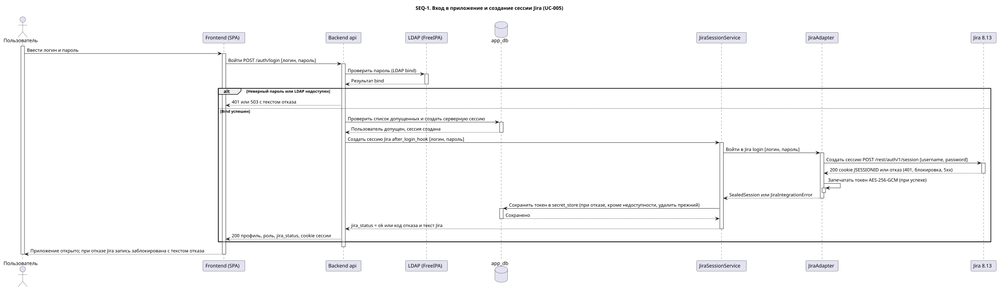
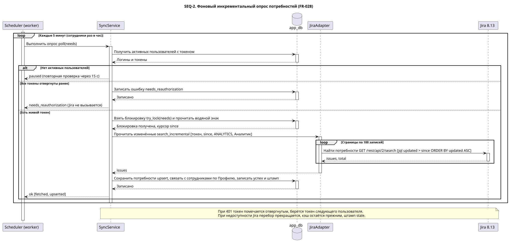
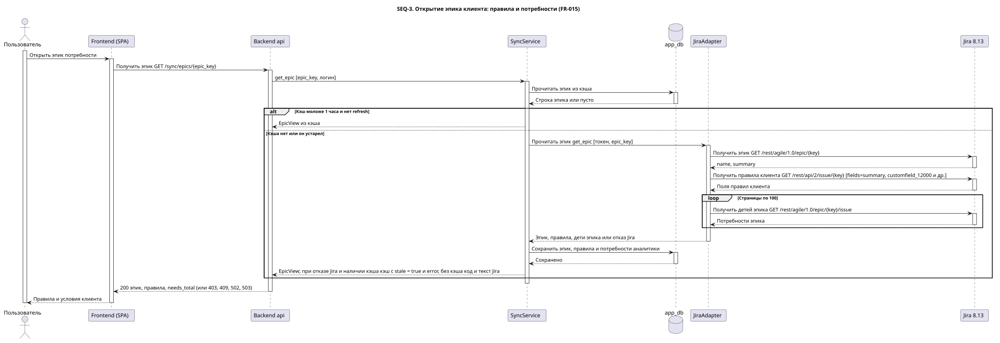
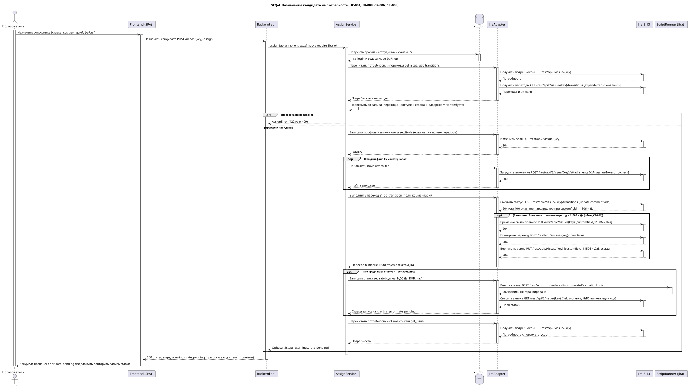
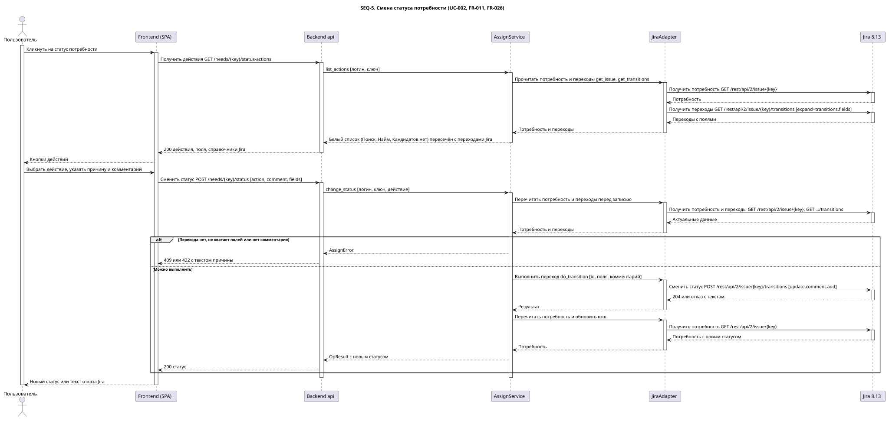
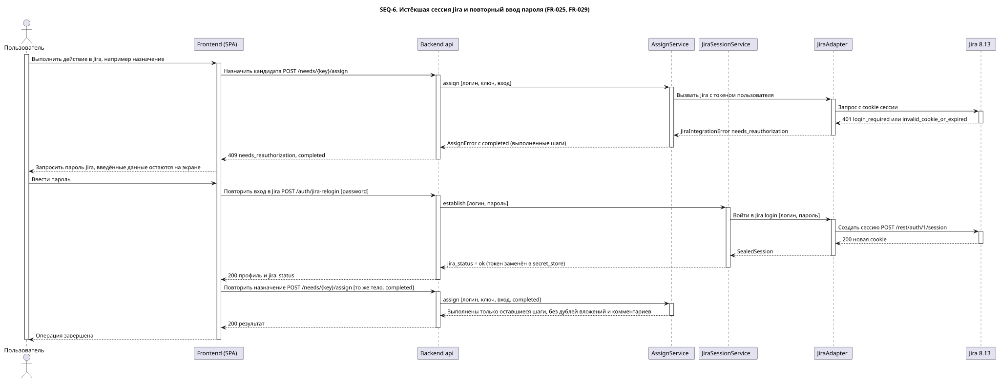

# SEQ — диаграммы последовательности интеграции с Jira

Формат: PlantUML, файлы в `seq/`. Проверены статическим валидатором скилла `analyst_uml_sequence_getanalyst` (`validate_sequence.py`: OK). Дополнительно отрисованы парсером PlantUML (официальный образ `plantuml/plantuml`, 26.10.2026): все 6 диаграмм без синтаксических ошибок; SVG лежат рядом с `.puml`. Перерисовать после правки: `bash product_docs/render_diagrams.sh`.
Каждая диаграмма зарегистрирована в графе трассировки 5.1 как `COMP-SEQ-*` со связью `satisfies` к исходному требованию (таблица ниже; копии сохранены инструментом в `output/data/re_web_presale/specs/comp_seq_jira*.puml`; **источник правки — файлы в `seq/`**, при изменении перерегистрировать).
Диаграммы описывают текущую реализацию (код + пробы KON-30/42/99), а не бейзлайн v1.0.

| ID | Сценарий | Файл | Исходное требование | Узел графа 5.1 |
|---|---|---|---|---|
| SEQ-1 | Вход и создание сессии Jira | `seq/seq1_login_jira_session.puml` | UC-005 | `COMP-SEQ-JiraLoginSession` |
| SEQ-2 | Фоновый инкрементальный опрос | `seq/seq2_incremental_sync.puml` | FR-028 | `COMP-SEQ-JiraIncrementalSync` |
| SEQ-3 | Открытие эпика: правила клиента | `seq/seq3_epic_rules.puml` | FR-015 | `COMP-SEQ-JiraEpicRules` |
| SEQ-4 | Назначение кандидата (с обходом CR-006 и ставкой CR-008) | `seq/seq4_assign_candidate.puml` | UC-001 | `COMP-SEQ-JiraAssignCandidate` |
| SEQ-5 | Смена статуса потребности | `seq/seq5_change_status.puml` | UC-002 | `COMP-SEQ-JiraChangeStatus` |
| SEQ-6 | Истёкшая сессия и повторный ввод пароля | `seq/seq6_session_expired.puml` | UC-005 | `COMP-SEQ-JiraSessionExpired` |

> Известная особенность инструмента регистрации: двоеточие в `title` на Windows превращает хвост имени файла в альтернативный поток NTFS. У `COMP-SEQ-JiraEpicRules` в `output/data/.../specs/` остался пустой файл-заглушка `comp_seq_jiraepicrules_открытие_эпика_клиента`; узел и связь в графе 5.1 корректны, источник диаграммы — `seq/seq3_epic_rules.puml`. В заголовках диаграмм двоеточие не использовать.

## Диаграммы

### SEQ-1. Вход и создание сессии Jira

Исходник: [`seq1_login_jira_session.puml`](seq/seq1_login_jira_session.puml)

### SEQ-2. Фоновый инкрементальный опрос

Исходник: [`seq2_incremental_sync.puml`](seq/seq2_incremental_sync.puml)

### SEQ-3. Открытие эпика: правила клиента

Исходник: [`seq3_epic_rules.puml`](seq/seq3_epic_rules.puml)

### SEQ-4. Назначение кандидата

Исходник: [`seq4_assign_candidate.puml`](seq/seq4_assign_candidate.puml)

### SEQ-5. Смена статуса потребности

Исходник: [`seq5_change_status.puml`](seq/seq5_change_status.puml)

### SEQ-6. Истёкшая сессия и повторный ввод пароля

Исходник: [`seq6_session_expired.puml`](seq/seq6_session_expired.puml)

## Ключевые моменты, которые диаграммы фиксируют

1. **Один ввод пароля — два назначения** (LDAP bind и сессия Jira); пароль не сохраняется (SEQ-1).
2. **Опрос идёт токеном активного пользователя**; нет пользователей — пауза; отвергнутый токен пропускается (SEQ-2).
3. **Дети эпика — только через Agile API** (SEQ-3).
4. **Порядок записи при назначении:** поля → вложения → переход 21 (комментарий всегда) → ставка ScriptRunner → перечитывание; ставка не откатывает назначение (SEQ-4).
5. **Обход валидатора «Вложение»** — три записи вокруг перехода, возврат `11506 = Да` выполняется всегда (SEQ-4, CR-006).
6. **Перед записью — перечитывание потребности и переходов** (SEQ-4, SEQ-5, FR-028).
7. **Истёкшая сессия — не потеря данных:** 409 + `completed`, повтор исполняет остаток (SEQ-6).

## Что не покрыто диаграммами
Ручное обновление `POST /sync/refresh` (повторяет SEQ-2 токеном пользователя), запись комментария без перехода (ветка FR-010), чтение сотрудников (SEQ-2 с `issuetype = "Epic"` и полной выгрузкой).
