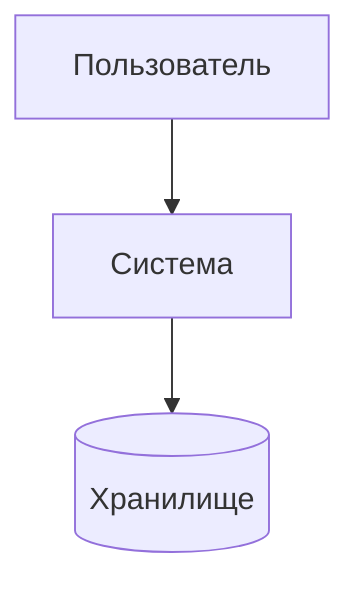
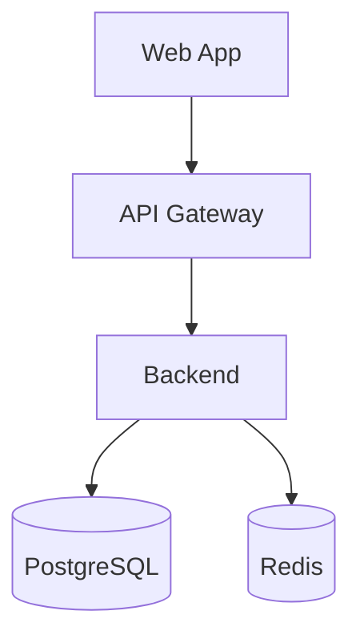
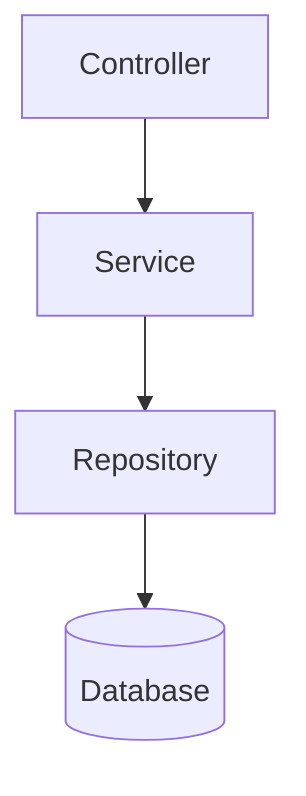
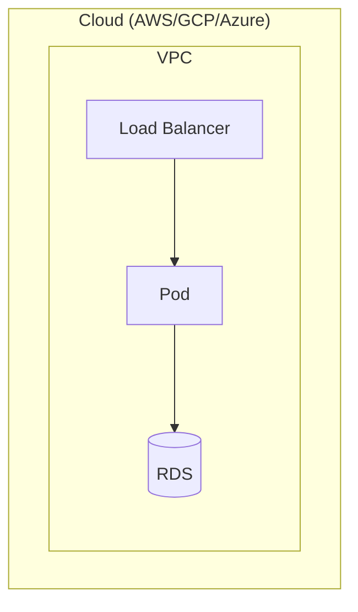
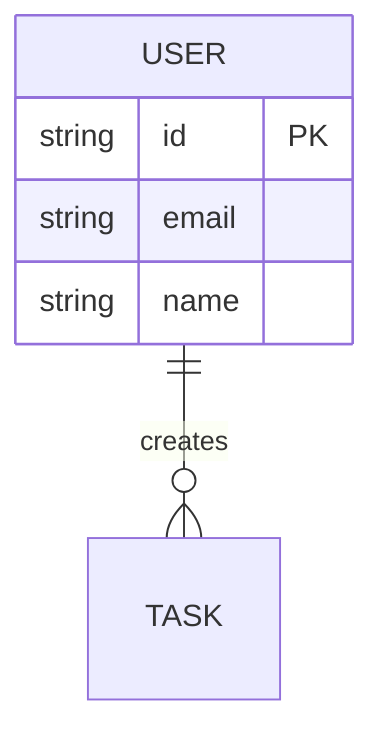
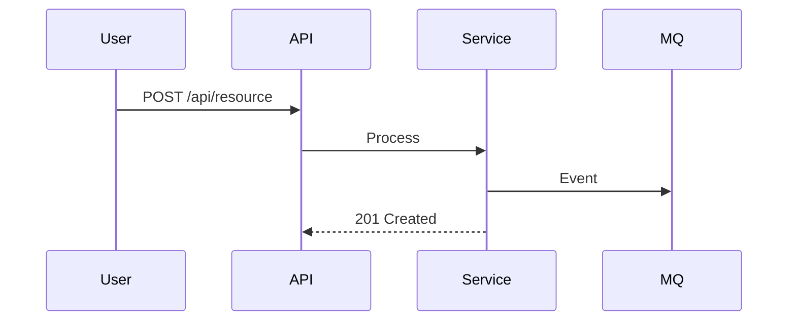

# Шаблоны вывода артефактов

## architecture-blueprint

Промежуточный артефакт — единый источник имён.

```markdown
## Architecture Blueprint

**Система:** [Название]
**Тип:** [web-application / microservices / api-service / ...]
**Профиль:** [quick / standard / enterprise / startup]
**Дата:** [YYYY-MM-DD]

### Системы и контейнеры
| Имя | Описание | Технология | Язык | Порт |
|-----|----------|------------|------|------|

### Ключевые решения
1. [Решение] — обоснование

### Предположения
- [Предположение] — источник: [шаблон/профиль/дефолт]

### Команда
| Параметр | Значение |
|----------|----------|

### Глоссарий
| Термин | Определение |
|--------|-------------|
```

## context-diagram

```markdown
## C4 Context Diagram

### Обзор
[2-3 предложения о системе и пользователях]

### Диаграмма


### Акторы
| Актор / Система | Роль | Тип | Описание |
|-----------------|------|-----|----------|

### Поток данных
- [Краткое описание]
```

## container-diagram

```markdown
## C4 Container Diagram

### Архитектурный стиль
[Монолит / Микросервисы / Layered / Event-driven]

### Диаграмма


### Контейнеры
| Контейнер | Технология | Язык | Ответственность | Данные |
|-----------|------------|------|-----------------|--------|

### Границы доверия
- [Описание зон доверия]
```

## component-diagram

```markdown
## C4 Component Diagram — [Название контейнера]

### Диаграмма


### Компоненты
| Компонент | Тип | Ответственность | Зависимости |
|-----------|-----|-----------------|-------------|
```

## deployment-diagram

```markdown
## C4 Deployment Diagram

### Инфраструктура
[Облако / On-premise / Hybrid]

### Диаграмма


### Окружения
| Окружение | Назначение | Ресурсы |
|-----------|------------|---------|
| Dev | Разработка | 1 replica |
| Staging | Тестирование | 2 replicas |
| Production | Продакшен | N replicas + HA |

### Сетевая конфигурация
- [Подсети, security groups, firewall]
```

## data-model

```markdown
## Модель данных

### ER-диаграмма


### Сущности
| Сущность | Таблица | Ключевые поля | Связи |
|----------|---------|---------------|-------|

### Стратегия миграций
- [flyway/liquibase/manual]
```

## api-specification

```markdown
## Спецификация API

### Стиль
[REST / GraphQL / gRPC]

### Основные эндпоинты
| Метод | Путь | Описание | Auth | Rate Limit |
|-------|------|----------|------|------------|

### Ключевые схемы
```yaml
User:
  type: object
  properties:
    id: { type: string, format: uuid }
    email: { type: string, format: email }
```

### Версионирование
[URL-based / Header-based]

### Обработка ошибок
```json
{ "error": { "code": "VALIDATION_ERROR", "message": "..." } }
```
```

## system-pattern

```markdown
## Архитектурный паттерн

### Выбранный паттерн
[Monolith / Microservices / Event-Driven / CQRS / Serverless / Layered]

### Обоснование
[Почему выбран, альтернативы]

### Структура
```
┌─────────────────────┐
│  Presentation Layer │
├─────────────────────┤
│  Application Layer  │
├─────────────────────┤
│   Domain Layer      │
├─────────────────────┤
│ Infrastructure Layer│
└─────────────────────┘
```

### Ключевые решения
- [Решение 1]
```

## data-flow

```markdown
## Потоки данных

### Диаграмма


### Потоки
| Поток | Источник | Направление | Протокол | Частота |
|-------|----------|-------------|----------|---------|

### Обработка ошибок
- [Retry policy]
- [Dead letter queue]
```

## security-architecture

```markdown
## Архитектура безопасности

### Аутентификация
[OAuth2 / JWT / Session / API Keys]

### Авторизация
[RBAC / ABAC / Permission-based]

### Матрица угроз (STRIDE)
| Угроза | Уровень | Митигация |
|--------|---------|-----------|

### Защита данных
- [Шифрование at rest: AES-256]
- [Шифрование in transit: TLS 1.3]
- [Хэширование паролей: bcrypt/argon2]
```

## nfr-matrix

```markdown
## Матрица нефункциональных требований

| Требование | Цель | Метрика | Приоритет |
|------------|------|---------|-----------|

### Риски
- [Риск] — [Митигация]
```

## technology-stack

```markdown
## Рекомендуемый стек технологий

### Фронтенд
| Компонент | Технология | Обоснование |
|-----------|------------|-------------|

### Бэкенд
| Компонент | Технология | Обоснование |
|-----------|------------|-------------|

### Инфраструктура
| Компонент | Технология | Обоснование |
|-----------|------------|-------------|
```

## integration-patterns

```markdown
## Паттерны интеграции

### Подход
[REST / Event-Driven / API Gateway / ESB / Message Broker]

### Интеграции
| Система | Протокол | Направление | Частота |
|---------|----------|-------------|---------|

### Паттерны
- **API Gateway** — единая точка входа, rate limiting, auth
- **Circuit Breaker** — защита от каскадных сбоев
- **Saga** — распределённые транзакции
- **Event Sourcing** — история изменений
```

## architecture-decision-records

```markdown
## ADR-NNN: [Название]

**Статус:** [Proposed | Accepted | Deprecated | Superseded]
**Дата:** [YYYY-MM-DD]

### Контекст
[Проблема и ограничения]

### Решение
[Выбранная технология и подход]

### Консеквенции
- [Положительное]
- [Отрицательное]

### Альтернативы
| Технология | Плюсы | Минусы | Итог |
|------------|-------|--------|------|
```

## compliance-mapping

```markdown
## Соответствие регуляторным требованиям

| Требование | Статус | Митигация |
|------------|--------|-----------|

### Стандарты
- [GDPR / HIPAA / SOC2 / PCI-DSS]
```

## migration-strategy

```markdown
## Стратегия миграции

### Этапы
| Этап | Описание | Длительность | Риски |
|------|----------|--------------|-------|

### Rollback-план
- [План отката]
```
