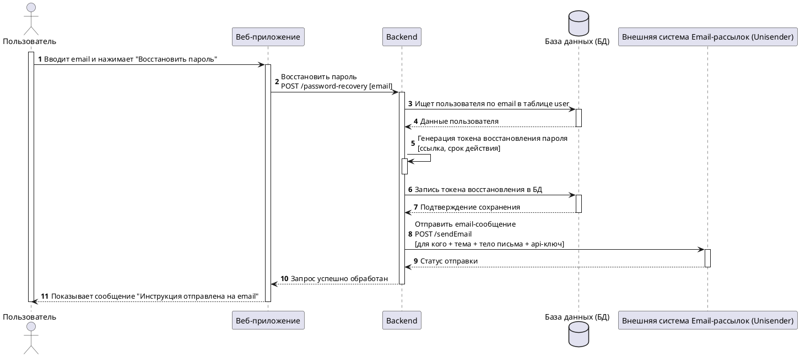
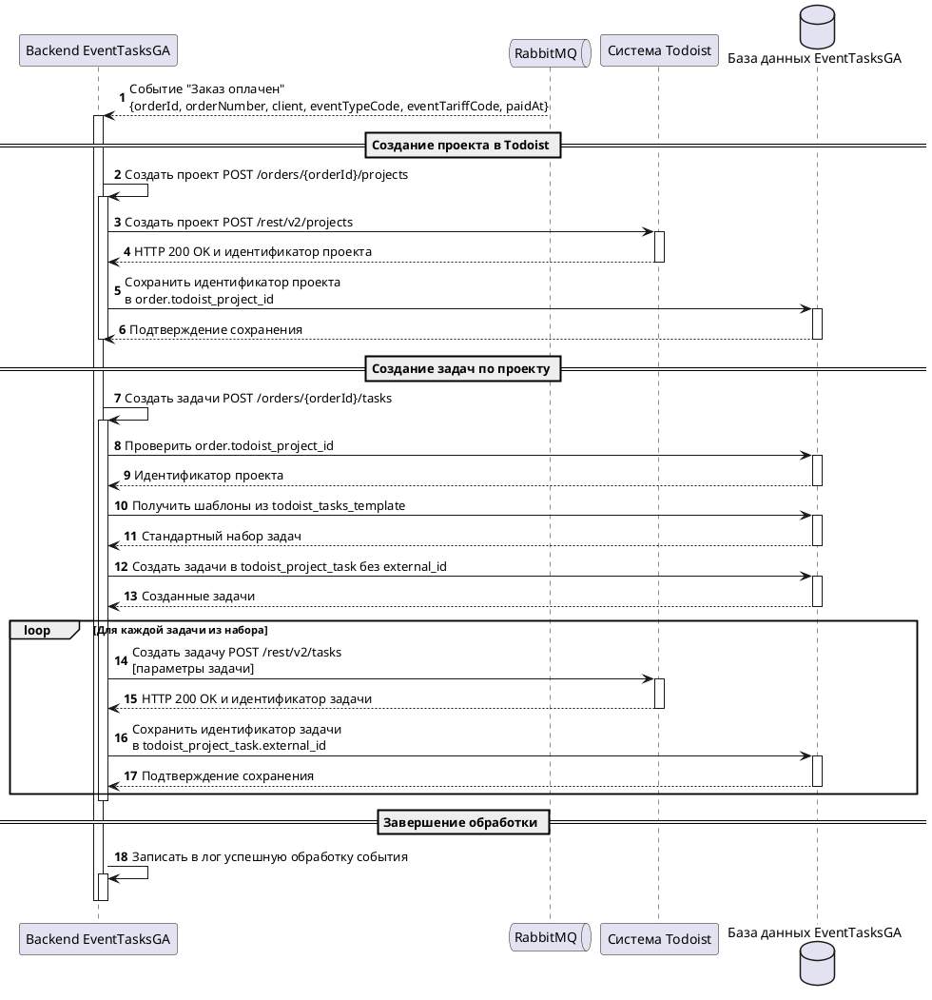

# Эталонные примеры UML Sequence

## Содержание

1. Восстановление пароля
2. Интеграция EventTasksGA с Todoist через RabbitMQ

Примеры задают стиль и правила, но не являются источником архитектуры для нового Use Case.
Не переносить из них участников, методы, таблицы, поля или ответы в другой сценарий.

## 1. Восстановление пароля

Почему пример эталонный:

- каждый участник активирован во время работы, включая первого инициатора;
- самовызов Backend имеет вложенный бар;
- запросы сплошные, ответы пунктирные и подписаны результатом;
- БД объявлена как `database`, внешняя система — как `participant`.

## 2. Интеграция EventTasksGA с Todoist через RabbitMQ

### Use Case

Роли пользователей:

- Клиент, заказывающий мероприятие.

Приложения и системы:

- Web-приложение EventTasksGA (Frontend).
- Сервер-приложение EventTasksGA (Backend).
- База данных EventTasksGA.
- RabbitMQ.
- Todoist — внешняя система.

Алгоритм работы:

1. В результате вызова одного из методов `POST /order/webhook` или
   `PATCH /order/{orderId}/status` на Backend EventTasksGA статус заказа обновляется на
   `paid` в БД.
2. Событие «Заказ оплачен» отправляется в соответствующую очередь RabbitMQ. Сообщение
   содержит:
   - `orderId`;
   - `orderNumber`;
   - `client`;
   - `eventTypeCode`;
   - `eventTariffCode`;
   - `paidAt`.
3. Обработчик Backend EventTasksGA получает событие из очереди и запускает интеграционный
   процесс создания проекта и задач по заказу во внешней системе.
4. Обработчик вызывает `POST /orders/{orderId}/projects` для создания проекта в Todoist.
   На вход передаются необходимые параметры названия проекта из сообщения RabbitMQ.
   1. Вызывается метод Todoist `POST https://api.todoist.com/rest/v2/projects`.
   2. Todoist возвращает успешный ответ с идентификатором созданного проекта.
   3. Backend записывает идентификатор в `order.todoist_project_id` БД EventTasksGA.
5. Обработчик вызывает `POST /orders/{orderId}/tasks` для создания стандартного набора задач
   по проекту на организацию мероприятия.
   1. Backend проверяет наличие идентификатора в `order.todoist_project_id`.
   2. Backend получает шаблоны из `todoist_tasks_template` и создаёт стандартный набор задач
      заказа в `todoist_project_task` без внешних идентификаторов.
   3. Для каждой созданной задачи:
      1. Backend вызывает Todoist:
         `POST https://api.todoist.com/rest/v2/tasks` с параметрами из маппинга данных.
      2. Todoist возвращает успешный ответ и идентификатор задачи.
      3. Backend записывает идентификатор в `todoist_project_task.external_id`.
6. Backend записывает в лог сообщение об успешной обработке события по заказу и завершает
   работу обработчика.

Диаграмма ниже сознательно начинается с доставки уже опубликованного события обработчику:
граница этого фрагмента — consumer-процесс.

### Код PlantUML

Почему пример эталонный:

- RabbitMQ объявлен как `queue` и никогда не активируется;
- доставка события показана пунктирной стрелкой с данными сообщения;
- внутренние интеграционные методы Backend показаны самовызовами с вложенными барами;
- для каждой задачи используется `loop`;
- идентификаторы проекта и задач сохраняются в конкретные поля, указанные в Use Case;
- отсутствует выдуманное подтверждение обработки в RabbitMQ.
